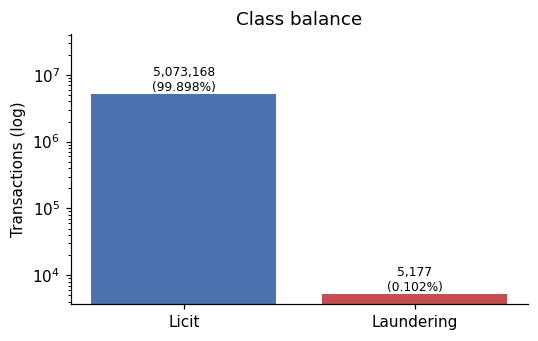
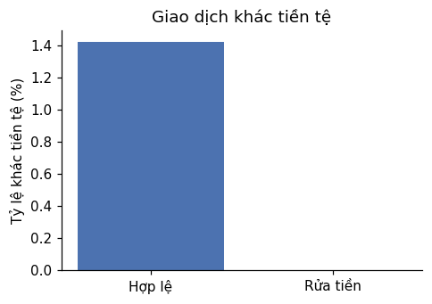
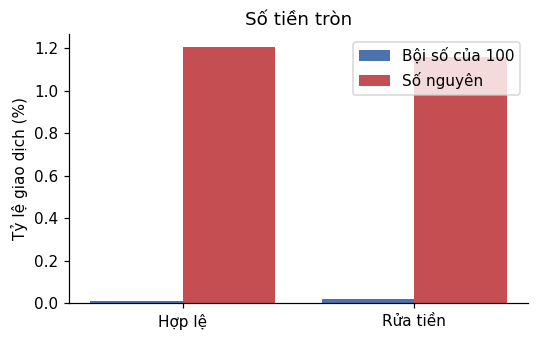
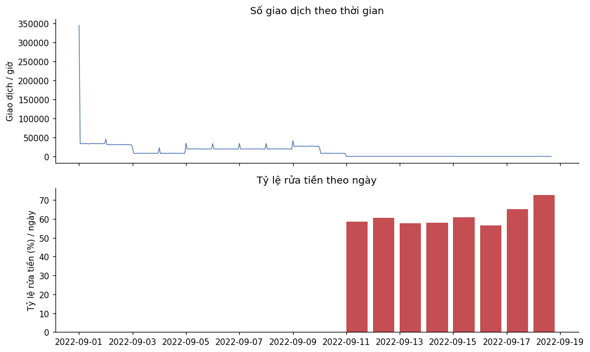

# Graph Analysis for Anti-Money Laundering
## Data
The data can be found online using the following link:
  - [IBM Transactions for Anti Money Laundering (AML)](https://www.kaggle.com/datasets/ealtman2019/ibm-transactions-for-anti-money-laundering-aml)

The data is generated using a multi-agent virtual world model. All of the agents in the virtual world have actions governed by statistical distributions. Thus the model and data are NOT based on obfuscating or anonymizing real individuals. Everything is synthetic. More specifically the underlying model uses a virtual world of banks, individuals, and companies -- with individuals and companies buying items, and doing bank transfers to make payments, get supplies, pay salaries, etc. The underlying model has good and bad actors, with bad actors doing things like smuggling, extortion, illegal gambling, etc. The bad actors sometimes attempt to launder ill-gotten funds resulting in money-laundering transactions.

**Variant used**: HI-Small — HI = higher illicit ratio, Small = smallest of three sizes
- `HI-Small_Trans.csv` contains individual transactions, including the Timestamp,From Bank,Account,To Bank,Account,Amount Received,Receiving Currency,
Amount Paid,Payment Currency,Payment Format,Is Laundering
- `HI-Small_Patterns.txt` groups a subset of labelled transactions into
  simulated laundering patterns
---
### HI-Small_Trans

| Cột gốc | Tên trong notebook | Ý nghĩa | Cách đọc |
|---|---|---|---|
| Timestamp | `timestamp` | Thời điểm, chính xác tới **phút** | `%Y/%m/%d %H:%M` |
| From Bank | `from_bank` | Mã ngân hàng gửi | chuỗi, giữ số 0 đầu; thêm `from_bank_id` dạng số |
| Account | `from_acct` | Số tài khoản gửi (hex) | chuỗi |
| To Bank | `to_bank` | Mã ngân hàng nhận | như trên |
| Account | `to_acct` | Số tài khoản nhận | chuỗi |
| Amount Received | `amt_received` | Số tiền nhận, theo tiền tệ nhận | giữ thêm chuỗi gốc |
| Receiving Currency | `recv_ccy` | 15 loại tiền tệ | |
| Amount Paid | `amt_paid` | Số tiền trả, theo tiền tệ trả | giữ thêm chuỗi gốc |
| Payment Currency | `pay_ccy` | | |
| Payment Format | `payment_format` | ACH, Cheque, Credit Card, Cash, Wire, Bitcoin, Reinvestment | |
| Is Laundering | `is_laundering` | 1 = rửa tiền | **chỉ dùng khi đánh giá** |
## Eight Laundering Pattern Types in the Dataset
- **Fan-Out**: One account distributes funds to many recipients simultaneously. Characteristic of placement — converting cash into the financial system through many small transfers.
- **Fan-In**: Many accounts funnel funds into one. Characteristic of integration — consolidating laundered money before final extraction.
- **Cycle**: Money moves through a chain of accounts and returns to the origin. Characteristic of layering — obscuring the money trail through circular transfers.
- **Stack**: Sequential chain transfers, each slightly reducing the amount. Designed to break the audit trail across multiple hops.
- **Bipartite**: Two groups of accounts transact exclusively between each other in an alternating pattern.
- **Gather-Scatter**: Funds collected from many sources, held briefly, then redistributed — a combination of fan-in and fan-out.
- **Scatter-Gather**: Funds distributed to intermediaries, which then all send to a single destination.
- **Random**: Multi-hop chains with random intermediate accounts, designed to evade pattern-matching rules.

| Typology | Số attempt | Số giao dịch | Giao dịch / attempt |
|---|---:|---:|---:|
| GATHER-SCATTER | 51 | 716 | 14,0 |
| SCATTER-GATHER | 44 | 626 | 14,2 |
| STACK | 43 | 466 | 10,8 |
| FAN-OUT | 48 | 342 | 7,1 |
| FAN-IN | 40 | 318 | 8,0 |
| CYCLE | 54 | 287 | 5,3 |
| BIPARTITE | 49 | 263 | 5,4 |
| RANDOM | 41 | 191 | 4,7 |
| **Tổng** | **370** | **3.209** | |

- Cả 3.209/3.209 dòng trong file pattern đều ghép được với giao dịch trong file chính. Tuy nhiên chúng chỉ chiếm **62,0%** trong 5.177 giao dịch rửa tiền. 38% còn lại có nhãn 1 nhưng không thuộc attempt nào được liệt kê. 
---

## Problem Statements
**Ground rules**
1. The graph is built without the Is Laundering label. The label is only used at the end, to score the rules.
2. No machine learning. Detection comes from graph structure (who pays whom, in which order, how much).
3. A rule only counts if it beats two non-graph baselines: random (0.10 % laundering) and “ACH format only” (0.72 %, ≈ 7×, covers 85 % of laundering).

**PS1: Fan-in / fan-out “smurfing” hubs**
- **Question**: Is laundering concentrated in accounts that collect money from, or spread it   to, unusually many counterparties in a short time?
- **Why**: This is the classic collection/distribution typology (FAN-IN, FAN-OUT, GATHER-SCATTER): many small senders feed one collector, or one account sprays money out.
- **Graph method**: Count distinct counterparties per account in 24–48 h windows, add a burstiness measure, then rank accounts against their peers.
- **Early signal**: Top 0.1–1 % of ACH accounts by degree: 7–25 % are laundering accounts, vs 2.3 % for ACH accounts overall (3–11×).
  
**PS2: Round-tripping: time-ordered money cycles**
- **Question**: When money leaves an account and comes back to it through a loop of other accounts, in time order, is that laundering?
- **Why**: The CYCLE typology: funds go round a loop and return to their origin looking “clean”. It is the core of the layering stage.
- **Graph method**: Find strongly connected components, enumerate cycles of length 3–6 (Johnson's algorithm), and keep only time-respecting cycles (each hop happens after the previous one).
- **Early signal**: Transactions on time-respecting ACH cycles are 22 % laundering (≈ 218× random, 30× the ACH baseline). Recall is only about 5 %, so the rule is precise but narrow.

**PS3: Layering chains and pass-through (mule) accounts**
- **Question**: Can we trace money that passes quickly through a chain of intermediary accounts while keeping most of its amount?
- **Why**: Chain/STACK typologies and money mules: an account receives money and forwards almost the same amount within hours, so it is a pipe, not a wallet.
- **Graph method**: Match each outflow to a recent inflow (within 72 h, keeping 80–100 % of the amount), then link the matched hops into time-respecting paths.
- **Early signal**: Pass-through ACH transfers are 4.0 % laundering (≈ 40× random, 5.5× the ACH baseline), with recall about 7 %. Whether longer chains are more suspicious is not yet tested.

**PS4: Split-and-merge: scatter-gather motifs**
- **Question**: Are two accounts linked by several parallel short paths through low-activity “middle” accounts a laundering signature?
- **Why**: The SCATTER-GATHER and BIPARTITE typologies: split a sum, route it through throw-away accounts, then merge it again.
- **Graph method**: Count 2-hop paths with a sparse matrix product A·K·A, where K keeps only low-degree intermediaries, then add a time-order check.
- **Early signa**: Pairs with ≥ 3 low-degree intermediaries: 44 accounts, and all 44 are laundering. With ≥ 2 intermediaries: 239 accounts, 23 % laundering. Very precise, but it covers few cases.

**PS5: One bank vs. the whole network**
- **Question**: How much laundering structure does a single bank miss when it sees only its own customers' transactions, compared with a shared (consortium) view?
- **Why**: Real banks see only their own side of the graph, and this dataset is rare in showing the whole ecosystem. The answer informs policy on inter-bank information sharing.
- **Graph method**: Re-run the PS1–4 rules on each bank's own view of the graph and compare with the full graph. Then plot recall against the number of banks that share data.
- **Early signal**: Only 3 of 39 laundering loop structures (7.7 %) are fully visible to any single bank, and a median of 3 banks is involved. One-hop rules (PS1) lose nothing, because every transaction of an account passes through its own bank. Multi-hop rules (PS2–4) lose most of their structure.
---
## Khung phương pháp

### Ba giai đoạn

1. **Dựng đồ thị và tính đặc trưng.** Sử dụng toàn bộ giao dịch đủ điều kiện trong phạm vi phân tích của từng bài toán. Nhãn `Is Laundering` được giữ riêng cho giai đoạn đánh giá.

2. **Áp dụng quy tắc phát hiện và xếp hạng.** Chốt tham số của quy tắc, cách xử lý đồng hạng và số lượng cảnh báo trước khi đối chiếu với nhãn. Tạo danh sách cảnh báo từ kết quả xếp hạng theo các mức đã xác định.

3. **Đánh giá sau khi tạo cảnh báo (*post-hoc*).** Ghép nhãn với kết quả phát hiện để tính precision, recall và lift. Khi so sánh trực tiếp quy tắc với đối chứng, sử dụng cùng đơn vị đánh giá, cùng tập đánh giá và cùng số lượng cảnh báo.

### Chỉ số đánh giá

Nghiên cứu đánh giá kết quả tại ba mức cảnh báo tương ứng với **top 0,1%, 0,5% và 1%** của tập ứng viên. Tại mỗi mức, `k` là số đơn vị được chọn và `TP_k` là số đơn vị có nhãn dương trong nhóm được chọn.

| Chỉ số | Cách tính và diễn giải |
| --- | --- |
| **Precision@k** | `TP_k / k`. Cho biết tỷ lệ cảnh báo đúng trong `k` đơn vị được chọn. Mỗi giá trị được báo cáo kèm **khoảng tin cậy Wilson 95%**. |
| **Recall@k trong tập ứng viên** | `TP_k / số đơn vị dương trong tập ứng viên`. Đo mức độ bao phủ trong phạm vi áp dụng quy tắc phát hiện. |
| **Recall@k trên toàn đoạn đánh giá** | `TP_k / tổng số đơn vị dương trong đoạn đánh giá`. Mẫu số bao gồm cả các đơn vị nằm ngoài tập ứng viên. |
| **Lift@k** | `Precision@k / tỷ lệ dương của baseline`. Baseline được xác định ở cùng cấp đánh giá với quy tắc phát hiện, tức cấp tài khoản hoặc cấp giao dịch. |
| **Average Precision (AP)** | Được tính trên toàn bộ danh sách ứng viên đã xếp hạng để đánh giá hiệu quả qua nhiều ngưỡng cảnh báo. Khi lớp dương chỉ chiếm khoảng 0,1% số giao dịch, đường precision–recall phản ánh rõ hơn chất lượng cảnh báo và khả năng bao phủ lớp dương so với đường ROC (Saito & Rehmsmeier, 2015). |

**Xử lý đồng hạng.** Các đơn vị có cùng điểm được sắp thứ tự ngẫu nhiên với một `seed` cố định để bảo đảm khả năng tái lập. Nếu ngưỡng `k` cắt qua một nhóm đồng hạng, bảng kết quả ghi số đơn vị được chọn từ nhóm đó. Các chỉ số được tính lại với **10 seed** để báo cáo mức dao động do cách xử lý đồng hạng.

## 4. Phân tích khám phá dữ liệu (EDA)

[Notebook EDA](01_eda_hi_small.ipynb) dùng DuckDB để phân tích tệp gốc `HI-Small_Trans.csv`. Các bảng kết quả và biểu đồ được lưu lần lượt trong `reports/tables/` và `reports/figures/`.

### 4.1. Quy mô dữ liệu

| Chỉ số | Giá trị |
| --- | ---: |
| Giao dịch | 5.078.345 |
| Tài khoản phân biệt theo khóa ghép | 515.088 |
| Mã ngân hàng phân biệt theo chuỗi gốc | 30.528 |
| Thời gian quan sát | 01/09/2022 00:00 đến 18/09/2022 16:18 |
| Độ dài kỳ quan sát | 17,7 ngày |

### 4.2. Mất cân bằng lớp

| Nhãn | Số giao dịch | Tỷ lệ |
| --- | ---: | ---: |
| Hợp lệ (0) | 5.073.168 | 99,898% |
| Rửa tiền (1) | 5.177 | 0,102% |

Bình quân khoảng 981 giao dịch có một giao dịch mang nhãn rửa tiền. Dự đoán mọi giao dịch là hợp lệ vẫn đạt accuracy khoảng 99,9%. Vì vậy, các kết quả phát hiện được đánh giá theo các chỉ số ở mục 3.4, trong đó precision và recall cho biết chất lượng và mức độ bao phủ của cảnh báo.

### 4.3. Tỷ lệ rửa tiền theo phương thức thanh toán và tiền tệ

| Phương thức | Tổng số giao dịch | Số giao dịch rửa tiền | Tỷ lệ |
| --- | ---: | ---: | ---: |
| ACH | 600.797 | 4.483 | 0,746% |
| Bitcoin | 146.091 | 56 | 0,038% |
| Cash | 490.891 | 108 | 0,022% |
| Cheque | 1.864.331 | 324 | 0,017% |
| Credit Card | 1.323.324 | 206 | 0,016% |
| Reinvestment | 481.056 | 0 | 0,000% |
| Wire | 171.855 | 0 | 0,000% |

ACH chiếm **11,8% tổng số giao dịch** và chứa **86,6% số giao dịch mang nhãn rửa tiền**. Tỷ lệ dương trong nhóm ACH cao gấp khoảng 7,3 lần mức nền trên CSV gốc. Vì vậy, ACH-only được sử dụng làm đối chứng ở cấp giao dịch. Xét theo đồng tiền thanh toán, Saudi Riyal có tỷ lệ dương cao nhất, ở mức **0,420%**.

### 4.4. Giao dịch có đồng tiền gửi và nhận khác nhau

Có 72.170 giao dịch có đồng tiền thanh toán khác đồng tiền nhận, tương ứng với 1,423% số giao dịch hợp lệ. Toàn bộ 5.177 giao dịch mang nhãn rửa tiền trong CSV gốc có cùng đồng tiền thanh toán và đồng tiền nhận.

### 4.5. Phân phối số tiền thanh toán quy đổi sang USD

Tỷ giá được ước tính từ dữ liệu tổng hợp. Với mỗi cặp tiền tệ, notebook lấy trung vị của `amt_received / amt_paid` trên các giao dịch khác đồng tiền có số tiền thanh toán từ 100 đơn vị trở lên. Sau đó, notebook quy đổi thông qua các cặp nối với USD, ưu tiên các cặp có nhiều quan sát hơn trong quá trình duyệt. [Bảng tỷ giá](reports/tables/fx_rates.csv)

| Nhóm giao dịch | Q1 (USD) | Trung vị (USD) | Q3 (USD) |
| --- | ---: | ---: | ---: |
| Hợp lệ (mẫu ngẫu nhiên khoảng 5%) | 158 | 889 | 5.232 |
| Rửa tiền | 2.161 | 5.879 | 13.759 |

Trong mẫu phân tích, trung vị số tiền thanh toán của nhóm rửa tiền cao gấp khoảng 6,6 lần nhóm hợp lệ. Phân phối lệch phải, với giá trị lớn nhất trong mẫu khoảng 16,3 tỷ USD. Bảng sử dụng trung vị và tứ phân vị để mô tả số tiền giao dịch.

### 4.6. Số tiền tròn

| Nhóm giao dịch | Số tiền là bội số của 100 | Số tiền là số nguyên |
| --- | ---: | ---: |
| Hợp lệ | 0,012% | 1,207% |
| Rửa tiền | 0,019% | 1,159% |

Các tỷ lệ trên được tính theo đồng tiền thanh toán. Chênh lệch tuyệt đối giữa hai nhóm nhỏ trong thống kê mô tả.

### 4.7. Phân bố giao dịch theo thời gian

| Kỳ | Số giao dịch | Số giao dịch rửa tiền | Tỷ lệ |
| --- | ---: | ---: | ---: |
| `dev` · 01–06/09 | 3.248.921 | 2.530 | 0,078% |
| `test` · 07–10/09 | 1.828.316 | 1.992 | 0,109% |
| `tail` · 11–18/09 | 1.108 | 655 | 59,116% |

Giai đoạn 11–18/09 chiếm **0,022% tổng số giao dịch** và chứa **12,7% số giao dịch rửa tiền** trong CSV gốc. EDA xác định đoạn đuôi từ ngày đầu tiên mà ngày đó và tất cả các ngày sau đều có số giao dịch dưới 5% trung vị số giao dịch theo ngày. Kỳ chính được chia theo thời lượng, với 60% đầu cho `dev` và 40% cuối cho `test`. Các mốc được lưu trong `reports/tables/analysis_period.json`. Đoạn `tail` được báo cáo riêng trong phân tích độ nhạy.

### 4.8. Tiền xử lý dữ liệu để dựng đồ thị

| Bước | Số giao dịch loại bỏ | Số giao dịch còn lại |
| --- | ---: | ---: |
| Đọc CSV gốc | — | 5.078.345 |
| Loại giao dịch có cùng tài khoản gửi và nhận (*self-loop*) | 591.212 | 4.487.133 |
| Giữ một bản đại diện cho mỗi nhóm giao dịch trùng | 9 | 4.487.124 |

Các nhóm trùng được xác định bằng 10 trường dữ liệu nguồn. Notebook giữ nguyên chuỗi số tiền để nhận diện dòng trùng và kiểm tra sự nhất quán của nhãn trong từng nhóm.

EDA lưu các giao dịch dùng để dựng đồ thị vào `hi_small_graph_transactions.parquet` và các giao dịch đã loại vào `hi_small_removed_transactions.parquet`. PS1 ghép lại hai tệp khi đánh giá trên phạm vi CSV gốc. **11 self-loop mang nhãn rửa tiền** vì vậy vẫn nằm trong mẫu số recall ở các đoạn tương ứng.

### 4.9. Baseline cấp giao dịch

Random dùng tỷ lệ dương của tập đánh giá làm precision kỳ vọng. ACH-only gắn cờ mọi giao dịch có phương thức ACH trong tập đó.

| Tập đánh giá | Đối chứng | Số cảnh báo | Số cảnh báo đúng | Precision | Recall | Lift so với Random |
| --- | --- | ---: | ---: | ---: | ---: | ---: |
| CSV gốc | Random (kỳ vọng) | — | — | 0,1019% | — | 1,00× |
| CSV gốc | ACH-only | 600.797 | 4.483 | 0,7462% | 86,5946% | 7,32× |
| Sau tiền xử lý | Random (kỳ vọng) | — | — | 0,1151% | — | 1,00× |
| Sau tiền xử lý | ACH-only | 529.446 | 4.472 | 0,8447% | 86,5660% | 7,34× |

EDA lưu baseline của tập sau tiền xử lý trong [`eda_transaction_baselines.csv`](reports/tables/eda_transaction_baselines.csv). [Notebook PS1](03_ps1_hi_small.ipynb) tính lại baseline cấp giao dịch trên từng đoạn của CSV gốc. Để so sánh ở cùng ngân sách cảnh báo, PS1 lấy thêm mẫu ACH ngẫu nhiên có cùng số giao dịch được chọn với quy tắc phát hiện.

## 5. Dựng đồ thị giao dịch

[Notebook dựng đồ thị](02_build_graph_hi_small_duckdb.ipynb) đọc tệp giao dịch sau tiền xử lý, tạo danh sách đỉnh và cạnh bằng DuckDB, rồi tính thành phần liên thông trên ma trận thưa bằng SciPy.

### 5.1. Định nghĩa đồ thị

Mạng giao dịch được biểu diễn dưới dạng **đa đồ thị có hướng, có thời gian và có trọng số**.

$$
G = (V, E, s, d, t, w)
$$

- $V$ là tập tài khoản. Mỗi đỉnh đại diện cho một tài khoản tại một ngân hàng.
- $E$ là tập cạnh. Mỗi giao dịch sau tiền xử lý tương ứng với một cạnh riêng.
- $s(e)$ và $d(e)$ lần lượt là tài khoản gửi và nhận của cạnh $e$.
- $t(e)$ là timestamp của giao dịch, với độ phân giải đến phút.
- $w(e)$ là số tiền thanh toán của từng cạnh quy đổi sang USD.

Các giao dịch giữa cùng một cặp tài khoản vẫn là những cạnh riêng, kể cả khi diễn ra trong cùng một phút. Danh sách `directed_pairs` lưu mỗi cặp gửi–nhận phân biệt một lần để tính bậc và thành phần liên thông.

### 5.2. Định danh đỉnh

Khóa đỉnh có dạng `account_key = bank_code + "_" + account_id`. Mã ngân hàng và mã tài khoản được lưu dưới dạng chuỗi để bảo toàn các số 0 ở đầu. `node_id` được gán theo thứ tự sắp xếp của `account_key` trên toàn mạng. Các đồ thị lọc theo ACH hoặc theo ngân hàng sử dụng cùng bộ định danh.

### 5.3. Thuộc tính cạnh

| Cột trong `graph_edges.parquet` | Ý nghĩa |
| --- | --- |
| `transaction_id` | Định danh giao dịch, đánh số từ 1 theo vị trí dòng dữ liệu trong CSV gốc |
| `source_id`, `target_id` | `node_id` của tài khoản gửi và nhận |
| `src`, `dst` | Khóa ghép của tài khoản gửi và nhận |
| `timestamp`, `timestamp_s` | Thời điểm giao dịch ở dạng datetime và số giây epoch |
| `from_bank`, `to_bank` | Mã ngân hàng dạng chuỗi gốc ở hai đầu |
| `amt_paid`, `pay_ccy` | Số tiền và đồng tiền thanh toán |
| `amount_received`, `recv_ccy` | Số tiền và đồng tiền nhận |
| `payment_format` | Phương thức thanh toán |
| `amt_usd`, `weight` | Số tiền thanh toán của từng cạnh quy đổi sang USD trong chế độ `usd` |

Nhãn `is_laundering` được lấy từ các tệp giao dịch của EDA và ghép theo `transaction_id` ở bước đánh giá.

### 5.4. Cách sử dụng đồ thị trong từng bài toán

| Bài toán | Thông tin sử dụng |
| --- | --- |
| **PS1 · Fan-in / fan-out** | Đếm đối tác ACH phân biệt theo hướng trong cửa sổ 24 hoặc 48 giờ. Mỗi đối tác đóng góp một đơn vị nếu xuất hiện ít nhất một lần trong cửa sổ. B3 đếm đối tác phân biệt trên toàn bộ đoạn đánh giá. |
| **PS2 · Chu trình giao dịch** | Dùng các cặp gửi–nhận phân biệt để tính SCC. Khi tìm chu trình, kiểm tra hướng và timestamp của từng giao dịch. Số tiền từng bước được dùng để mô tả chu trình. |
| **PS5 · Phạm vi quan sát của ngân hàng** | Giữ các cạnh có ngân hàng gửi hoặc ngân hàng nhận thuộc nhóm đang xét. Mỗi `transaction_id` xuất hiện một lần trong phạm vi của nhóm. |

### 5.5. Kích thước và phân phối bậc

| Chỉ số | Toàn bộ phương thức | Chỉ ACH |
| --- | ---: | ---: |
| Đỉnh (tài khoản) | 422.734 | 238.922 |
| Cạnh (giao dịch) | 4.487.124 | 529.446 |
| Cặp gửi–nhận phân biệt | 647.939 | 208.522 |
| Cạnh vượt quá cạnh đầu tiên của mỗi cặp | 3.839.185 (85,6%) | 320.924 (60,6%) |

Đồ thị toàn mạng có 23.432 mã ngân hàng. Bậc của mỗi đỉnh được tính theo số đối tác phân biệt.

| Bậc trên toàn mạng | Trung vị | P90 | P99 | Lớn nhất |
| --- | ---: | ---: | ---: | ---: |
| Bậc vào (*in-degree*) | 1 | 3 | 7 | 545 |
| Bậc ra (*out-degree*) | 1 | 3 | 10 | 14.230 |

### 5.6. Thành phần liên thông

| Phạm vi | Loại thành phần | Số thành phần | Số đỉnh của thành phần lớn nhất | Số thành phần có hơn một đỉnh |
| --- | --- | ---: | ---: | ---: |
| Toàn bộ phương thức | Mạnh (SCC) | 402.415 | 17.075 | 2.928 |
| Toàn bộ phương thức | Yếu | 21.785 | 372.089 | 21.785 |
| Chỉ ACH | Mạnh (SCC) | 235.452 | 25 | 3.043 |
| Chỉ ACH | Yếu | 50.331 | 23.653 | 50.331 |

Thống kê ACH được tính trên 238.922 tài khoản xuất hiện trong tập ACH. Mỗi chu trình có hướng nằm trong một SCC. PS2 tìm chu trình đơn dài 3–6 cạnh nên có thể giới hạn tìm kiếm vào các SCC có ít nhất ba tài khoản, rồi kiểm tra thứ tự thời gian trên từng giao dịch.

  

  
