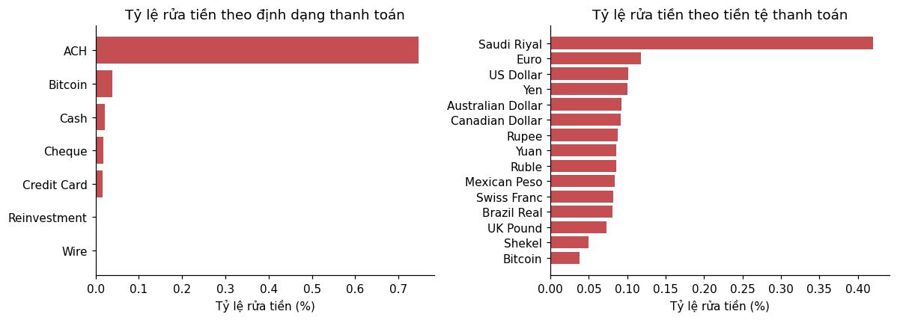
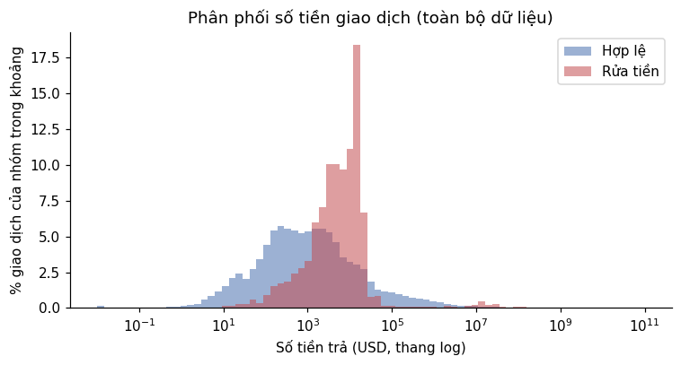

# Hubs and Loops: phát hiện rửa tiền bằng quy tắc đồ thị trên IBM AML HI-Small

**Tên đề tài:** Tài khoản trung tâm và vòng tiền khép kín: phát hiện rửa tiền bằng các quy tắc đồ thị có thể giải thích trên mạng giao dịch IBM HI-Small
**English title:** *Hubs and Loops: Explainable Graph Rules for Anti-Money Laundering on the IBM HI-Small Transaction Network*

Khóa luận tốt nghiệp K65 · Nguyễn Thị Kiều Trinh

---

## 1. Phát biểu vấn đề

Ngân hàng sàng lọc từng giao dịch riêng lẻ và ngập trong cảnh báo. Trong bộ dữ liệu này, quy tắc đơn giản nhất có ý nghĩa là "gắn cờ mọi giao dịch ACH". Trên đoạn kiểm thử dài 4,5 ngày, quy tắc đó tạo ra **262.486 cảnh báo** nhưng chỉ **0,74%** là rửa tiền.

Một giao dịch rửa tiền nhìn riêng thì giống giao dịch bình thường. Nhưng để che giấu nguồn gốc, tiền phải đi qua nhiều tài khoản, và việc đó để lại **hình dạng** trong mạng giao dịch.

Khóa luận kiểm tra hai hình dạng: **hub** (tài khoản giao dịch với rất nhiều đối tác) và **loop** (vòng tiền đi qua nhiều tài khoản rồi quay về đúng thứ tự thời gian). Câu hỏi là: các hình dạng này có tìm ra rửa tiền chính xác hơn nhiều so với quy tắc cấp giao dịch không, khi không đọc nhãn và không dùng học máy?

## 2. Câu hỏi nghiên cứu

| RQ | Câu hỏi | Bài toán gốc | Notebook | 
|---|---|---|---|---|
| **RQ1 · Hubs** | Rửa tiền có tập trung ở tài khoản nhận tiền từ (*fan-in*) hoặc chuyển tiền cho (*fan-out*) rất nhiều đối tác trong thời gian ngắn không? Cửa sổ thời gian có thêm thông tin so với bậc (*degree*) thông thường không? | PS1 | `03_ps1_hi_small.ipynb`|
| **RQ2 · Loops** | Vòng tiền theo đúng thứ tự thời gian có phải tín hiệu rửa tiền chính xác hơn ACH-only, vòng tĩnh và "cùng SCC" không? | PS2 | `04_ps2_hi_small.ipynb` | 
| **RQ3 · Một ngân hàng** | Một ngân hàng chỉ thấy giao dịch của khách hàng mình thì thấy trọn được bao nhiêu loop? | PS5 (rút gọn) | `04_ps2_hi_small.ipynb` | 


## 3. Nguyên tắc chung

1. **Tách nhãn.** Đồ thị và mọi quy tắc được tính khi chưa đọc cột `Is Laundering`. Nhãn chỉ được ghép vào ở bước chấm điểm.
2. **Không học máy.** Tín hiệu chỉ đến từ cấu trúc đồ thị: ai trả cho ai, theo thứ tự nào, bao nhiêu.
3. **Phải vượt baseline.** Quy tắc chỉ có giá trị khi vượt baseline ngẫu nhiên và baseline **ACH-only**, ở cùng đơn vị đánh giá, cùng tập đánh giá và cùng ngân sách cảnh báo.
   - Trên cả file gốc: ngẫu nhiên 0,102%; ACH-only 0,746%, bắt được 86,6% giao dịch rửa tiền.
   - Trên đoạn test: ngẫu nhiên 0,110%; ACH-only 0,741%, bắt được 86,5%.
4. **Chọn trên dev, chấm trên test.** Mọi lựa chọn (biến thể PS1, ngưỡng δ của PS2) được chốt trên dev và lưu kèm mã hash trước khi tính bất kỳ số nào trên test.

## 4. Dữ liệu

Nguồn: [IBM Transactions for Anti Money Laundering (AML)](https://www.kaggle.com/datasets/ealtman2019/ibm-transactions-for-anti-money-laundering-aml), mô tả trong Altman et al. (2023). Đây là dữ liệu **tổng hợp**: một thế giới ảo gồm ngân hàng, cá nhân và doanh nghiệp mua bán, trả lương, chuyển khoản; một số tác nhân xấu rửa tiền thu được từ hoạt động phi pháp. Không có dữ liệu của người thật.

Bản dùng: **HI-Small** (HI = tỷ lệ rửa tiền cao hơn, Small = cỡ nhỏ nhất trong ba cỡ).

| File | Nội dung | Dùng ở |
|---|---|---|
| `HI-Small_Trans.csv` | 5.078.345 giao dịch, 11 cột | Mọi notebook |
| `HI-Small_Patterns.txt` | 370 lần rửa tiền (*attempt*) theo 8 kiểu, gồm 3.209 giao dịch | Chỉ để chấm điểm, và để hiệu chỉnh δ trên dev (nb 04) |
| `HI-Small_accounts.csv` | Loại chủ thể của tài khoản (công ty hợp danh, công ty, hộ kinh doanh…) | Nhóm đối chiếu và hồ sơ cảnh báo của PS1 (nb 03) |

### 4.1. Các cột của `HI-Small_Trans.csv`

| Cột gốc | Tên trong notebook | Ý nghĩa | Cách đọc |
|---|---|---|---|
| Timestamp | `timestamp` | Thời điểm, chính xác tới **phút** | `%Y/%m/%d %H:%M` |
| From Bank | `from_bank` | Mã ngân hàng gửi | Đọc dạng chuỗi; thêm `from_bank_id` dạng số |
| Account | `from_acct` | Số tài khoản gửi (hệ 16) | Chuỗi |
| To Bank | `to_bank` | Mã ngân hàng nhận | Như trên |
| Account | `to_acct` | Số tài khoản nhận | Chuỗi |
| Amount Received | `amt_received` | Số tiền nhận, theo tiền tệ nhận | Giữ thêm chuỗi gốc |
| Receiving Currency | `recv_ccy` | 15 loại tiền tệ | |
| Amount Paid | `amt_paid` | Số tiền trả, theo tiền tệ trả | Giữ thêm chuỗi gốc |
| Payment Currency | `pay_ccy` | | |
| Payment Format | `payment_format` | ACH, Cheque, Credit Card, Cash, Wire, Bitcoin, Reinvestment | |
| Is Laundering | `is_laundering` | 1 = rửa tiền | **Chỉ dùng khi chấm điểm** |

### 4.2. Tám kiểu rửa tiền trong `Patterns.txt`

- **FAN-OUT:** một tài khoản chuyển tiền cho nhiều tài khoản nhận.
- **FAN-IN:** nhiều tài khoản cùng chuyển tiền về một tài khoản.
- **GATHER-SCATTER:** gom từ nhiều nguồn về một tài khoản, rồi phân tán đi nhiều nơi.
- **SCATTER-GATHER:** chia từ một tài khoản qua nhiều trung gian, rồi các trung gian cùng chuyển về một đích.
- **CYCLE:** tiền đi qua một chuỗi tài khoản và quay về tài khoản ban đầu.
- **STACK:** nhiều lớp chuyển tiếp nối tiếp nhau.
- **BIPARTITE:** hai nhóm tài khoản chuyển tiền qua lại giữa nhau.
- **RANDOM:** chuỗi nhiều bước qua các tài khoản trung gian ngẫu nhiên.

| Kiểu | Số attempt | Số giao dịch | Giao dịch / attempt |
|---|---:|---:|---:|
| GATHER-SCATTER | 51 | 716 | 14,0 |
| SCATTER-GATHER | 44 | 626 | 14,2 |
| STACK | 43 | 466 | 10,8 |
| FAN-OUT | 48 | 342 | 7,1 |
| FAN-IN | 40 | 318 | 8,0 |
| CYCLE | 54 | 287 | 5,3 |
| BIPARTITE | 49 | 263 | 5,4 |
| RANDOM | 41 | 191 | 4,7 |
| **Tổng** | **370** | **3.209** | |

Cả 3.209 dòng của file pattern đều ghép được với giao dịch trong file chính, nhưng chỉ chiếm **62,0%** trong 5.177 giao dịch rửa tiền. 38% còn lại mang nhãn 1 mà không thuộc attempt nào. Vì vậy recall theo pattern luôn thấp hơn recall theo nhãn.

## 5. Chạy 

### 5.1. Thứ tự

| Bước | Notebook | Đọc | Ghi ra |
|---|---|---|---|
| 1 | `Notebook/01_eda_hi_small.ipynb` | CSV giao dịch, file pattern | `reports/tables/`, `reports/figures/`, `analysis_period.json`, `data/processed/hi_small_graph_transactions.parquet`, `hi_small_removed_transactions.parquet` |
| 2 | `Notebook/02_build_graph_hi_small_duckdb.ipynb` | Kết quả bước 1 | `data/processed/graph/graph_nodes.parquet`, `graph_edges.parquet` |
| 3 | `Notebook/03_ps1_hi_small.ipynb` | Kết quả bước 1–2, file accounts | `reports/ps1/` |
| 4 | `Notebook/04_ps2_hi_small.ipynb` | Kết quả bước 1–2, file pattern | `reports/ps2/` |

Mỗi notebook chạy bằng *Restart & Run All*, không cần sửa code.

### 5.2. Cài đặt và đường dẫn

```bash
pip install -r requirements.txt
```

Đặt đường dẫn bằng biến môi trường trước khi mở Jupyter:

| Biến | Ý nghĩa | Notebook dùng |
|---|---|---|
| `HI_SMALL_ROOT` | Thư mục dự án, nơi ghi `data/processed/` và `reports/` | 01–04 |
| `HI_SMALL_TRANS` | Đường dẫn tới `HI-Small_Trans.csv` | 01 |
| `HI_SMALL_PATTERNS` | Đường dẫn tới `HI-Small_Patterns.txt` | 01, 04 |
| `HI_SMALL_ACCOUNTS` | Đường dẫn tới `HI-Small_accounts.csv` | 03 |

Trên Kaggle, notebook 01 tự tìm file trong `/kaggle/input` và ghi vào `/kaggle/working`. Ba file dữ liệu gốc và thư mục `data/` không được đưa lên repo (xem `.gitignore`).

## 6. Khung phương pháp

### 6.1. Ba giai đoạn

1. **Dựng đồ thị và tính đặc trưng** trên toàn bộ giao dịch đủ điều kiện, khi chưa đọc nhãn.
2. **Áp dụng quy tắc và xếp hạng.** Tham số, cách phá đồng hạng và ngân sách cảnh báo được chốt trước khi ghép nhãn.
3. **Chấm điểm sau cùng (*post-hoc*).** Ghép nhãn để tính precision, recall, lift. So sánh quy tắc với baseline luôn ở cùng đơn vị, cùng tập và cùng số cảnh báo.

### 6.2. Chia dev / test theo thời gian

| Đoạn | Thời gian | Giao dịch | Rửa tiền | Tỷ lệ | Vai trò |
|---|---|---:|---:|---:|---|
| **dev** | 01/09 00:00 → 06/09 13:00 | 3.035.199 | 2.272 | 0,075% | Chọn biến thể, hiệu chỉnh tham số |
| **test** | 06/09 13:00 → 11/09 00:00 (4,46 ngày) | 2.042.038 | 2.250 | 0,110% | Chấm điểm một lần, sau khi đã chốt |
| **đuôi** | 11/09 → 18/09 16:18 | 1.108 | 655 | 59,1% | Loại khỏi đánh giá chính; chỉ báo cáo độ nhạy |

Cách xác định, chốt trước khi xem nhãn và chỉ dựa vào số lượng giao dịch:

- **Đuôi** bắt đầu từ ngày đầu tiên mà ngày đó và mọi ngày sau đều có số giao dịch dưới 5% trung vị số giao dịch/ngày. Đây là phần mô phỏng chạy nốt các pattern sau khi dữ liệu nền đã dừng. Đuôi chỉ chiếm 0,022% số giao dịch nhưng chứa 12,7% số giao dịch rửa tiền, nên giữ lại sẽ làm kết quả đẹp giả.
- **Dev** là **60% số giao dịch** đầu tiên của kỳ chính, làm tròn xuống đầu giờ (thực tế 59,8%). **Test** là phần còn lại.
- Các mốc được lưu trong `reports/tables/analysis_period.json`, và mọi notebook sau đều đọc từ file này.

Lý do chia theo thời gian thay vì ngẫu nhiên: mô phỏng đúng cách triển khai thật (đặt quy tắc trên quá khứ, áp cho tương lai), và không xé một vòng tiền ra hai tập.

### 6.3. Chỉ số đánh giá

Kết quả được báo cáo tại ba mức ngân sách cảnh báo: **top 0,1%, 0,5% và 1%** của tập ứng viên. `k` là số đơn vị được chọn, `TP_k` là số đơn vị dương trong đó.

| Chỉ số | Cách tính và ý nghĩa |
|---|---|
| **Precision@k** | `TP_k / k`: tỷ lệ cảnh báo đúng. Luôn kèm **khoảng tin cậy Wilson 95%** (Wilson, 1927). Quy tắc thắng baseline khi cận dưới Wilson lớn hơn precision của baseline |
| **Recall@k trong tập ứng viên** | `TP_k / số đơn vị dương trong tập ứng viên` |
| **Recall@k trên cả đoạn** | `TP_k / tổng số đơn vị dương trong đoạn`, kể cả đơn vị nằm ngoài tập ứng viên |
| **Lift@k** | `Precision@k / tỷ lệ dương của baseline`, ở cùng cấp đánh giá (tài khoản hoặc giao dịch) |
| **Average Precision (AP)** | Tính trên toàn bộ danh sách đã xếp hạng. Khi lớp dương chỉ chiếm khoảng 0,1%, đường precision–recall phản ánh chất lượng cảnh báo rõ hơn đường ROC (Saito & Rehmsmeier, 2015) |

**Đơn vị đánh giá.** RQ1 chấm theo **tài khoản**: một tài khoản dương tính nếu gửi hoặc nhận ít nhất 1 giao dịch rửa tiền (bất kỳ định dạng nào, kể cả self-loop) trong đoạn. RQ2 chấm theo **giao dịch**: mẫu số là mọi giao dịch của đoạn trong file gốc.

**Xử lý đồng hạng.** Các đơn vị cùng điểm được xếp ngẫu nhiên với `seed` cố định. Nếu ngưỡng `k` cắt qua một nhóm đồng hạng, bảng kết quả ghi số đơn vị được chọn từ nhóm đó, và các chỉ số được tính lại với 10 seed để báo cáo mức dao động.

## 7. Phân tích khám phá (EDA)

Notebook 01 dùng DuckDB để đọc `HI-Small_Trans.csv`. Bảng lưu trong `reports/tables/`, hình lưu trong `reports/figures/`.

### 7.1. Quy mô

| Chỉ số | Giá trị |
|---|---:|
| Giao dịch | 5.078.345 |
| Tài khoản (khóa: mã ngân hàng dạng số + số tài khoản) | 515.088 |
| Mã ngân hàng dạng chuỗi gốc | 30.528 |
| Ngân hàng sau khi gộp số 0 đầu (`010` = `10`) | 30.470 |
| Thời gian quan sát | 01/09/2022 00:00 → 18/09/2022 16:18 (17,7 ngày) |

Mọi dòng trong file đều có mã ngân hàng viết kèm số 0 đầu. Khóa tài khoản dùng mã dạng số và khớp với cột `Bank ID` của `HI-Small_accounts.csv`. Không tài khoản nào bị tách đôi do cách viết mã ngân hàng (`reports/tables/eda_bank_codes.csv`).

### 7.2. Mất cân bằng lớp

| Nhãn | Số giao dịch | Tỷ lệ |
|---|---:|---:|
| Hợp lệ (0) | 5.073.168 | 99,898% |
| Rửa tiền (1) | 5.177 | 0,102% |


Trung bình cứ khoảng 981 giao dịch thì có 1 giao dịch rửa tiền. Đoán mọi giao dịch là hợp lệ vẫn đạt accuracy 99,9%, nên khóa luận đánh giá bằng các chỉ số ở mục 6.3.

### 7.3. Tỷ lệ rửa tiền theo định dạng thanh toán và tiền tệ

| Định dạng | Giao dịch | Rửa tiền | Tỷ lệ |
|---|---:|---:|---:|
| ACH | 600.797 | 4.483 | 0,746% |
| Bitcoin | 146.091 | 56 | 0,038% |
| Cash | 490.891 | 108 | 0,022% |
| Cheque | 1.864.331 | 324 | 0,017% |
| Credit Card | 1.323.324 | 206 | 0,016% |
| Reinvestment | 481.056 | 0 | 0,000% |
| Wire | 171.855 | 0 | 0,000% |



ACH chiếm **11,8%** tổng số giao dịch nhưng chứa **86,6%** giao dịch rửa tiền; tỷ lệ dương của ACH cao gấp khoảng 7,3 lần mức nền. Vì vậy ACH-only là baseline cấp giao dịch, và đồ thị con ACH là phạm vi chính của RQ1–RQ2. Theo tiền tệ thanh toán, Saudi Riyal có tỷ lệ cao nhất (0,420%).

### 7.4. Giao dịch khác tiền tệ

72.170 giao dịch hợp lệ (1,42%) có tiền tệ trả khác tiền tệ nhận; **không giao dịch rửa tiền nào** như vậy. Nhưng các vòng rửa tiền thường đổi tiền tệ **giữa các chặng**: mỗi chặng dùng một loại tiền khác nhau. Vì vậy khi so số tiền dọc một vòng phải quy đổi sang USD.

### 7.5. Số tiền quy đổi USD

Tỷ giá được ước lượng ngay từ dữ liệu: với mỗi cặp tiền tệ, lấy trung vị của `amt_received / amt_paid` trên các giao dịch khác tiền tệ có số tiền trả từ 100 trở lên, rồi nối các cặp về USD. Kết quả lưu trong [`fx_rates.csv`](reports/tables/fx_rates.csv).

| Nhóm | Q1 (USD) | Trung vị (USD) | Q3 (USD) |
|---|---:|---:|---:|
| Hợp lệ (mẫu ngẫu nhiên 5%, seed cố định) | 159 | 897 | 5.305 |
| Rửa tiền | 2.161 | 5.879 | 13.759 |



Trung vị của nhóm rửa tiền cao gấp khoảng 6,6 lần nhóm hợp lệ. Phân phối lệch phải mạnh (giao dịch rửa tiền lớn nhất khoảng 16,3 tỷ USD), nên bảng dùng trung vị và tứ phân vị.

### 7.6. Hoạt động theo thời gian


Từ 11/09 số giao dịch mỗi ngày giảm xuống còn vài trăm hoặc vài chục, trong khi tỷ lệ rửa tiền vọt lên 57–73%. Đó là đoạn đuôi được loại khỏi đánh giá (mục 6.2).

### 7.7. Tiền xử lý trước khi dựng đồ thị

| Bước | Loại bỏ | Còn lại |
|---|---:|---:|
| Đọc CSV gốc | — | 5.078.345 |
| Bỏ giao dịch có tài khoản gửi trùng tài khoản nhận (*self-loop*) | 591.212 | 4.487.133 |
| Bỏ dòng trùng hoàn toàn (giữ 1 bản mỗi nhóm) | 9 | **4.487.124** |

- Dòng trùng được xác định bằng 10 trường gốc, giữ nguyên chuỗi số tiền; không nhóm trùng nào có nhãn mâu thuẫn.
- Phần lớn self-loop là Reinvestment (481.056). **11 self-loop mang nhãn rửa tiền** (thuộc GATHER-SCATTER).
- Các dòng bị loại được lưu riêng, và vẫn nằm trong **mẫu số** khi tính recall, để không làm đẹp kết quả.

### 7.8. Baseline cấp giao dịch

| Tập | Baseline | Cảnh báo | Cảnh báo đúng | Precision | Recall | Lift so với ngẫu nhiên |
|---|---|---:|---:|---:|---:|---:|
| Cả file | Ngẫu nhiên (kỳ vọng) | — | — | 0,102% | — | 1,0× |
| Cả file | ACH-only | 600.797 | 4.483 | 0,746% | 86,6% | 7,3× |
| dev | ACH-only | 337.203 | 1.882 | 0,558% | 82,8% | 7,5× |
| **test** | Ngẫu nhiên (kỳ vọng) | — | — | 0,110% | — | 1,0× |
| **test** | **ACH-only** | **262.486** | **1.946** | **0,741%** | **86,5%** | **6,7×** |

Nguồn: [`eda_transaction_baselines.csv`](reports/tables/eda_transaction_baselines.csv). Để so ở cùng ngân sách, PS1 và PS2 còn lấy thêm một **mẫu ACH ngẫu nhiên có đúng bằng số cảnh báo** của quy tắc.

## 8. Đồ thị giao dịch

Notebook 02 đọc tập giao dịch đã tiền xử lý, dựng danh sách đỉnh và cạnh bằng DuckDB, và tính thành phần liên thông bằng SciPy.

### 8.1. Định nghĩa

Mạng giao dịch là một **đa đồ thị có hướng, có thời gian và có trọng số**:

$$G = (V, E, s, d, t, w)$$

- $V$: tập tài khoản; mỗi đỉnh là một tài khoản tại một ngân hàng.
- $E$: tập cạnh; mỗi giao dịch sau tiền xử lý là một cạnh riêng, kể cả khi cùng cặp tài khoản và cùng phút.
- $s(e)$, $d(e)$: tài khoản gửi và nhận của cạnh $e$.
- $t(e)$: thời điểm giao dịch, chính xác tới phút.
- $w(e)$: số tiền trả quy đổi USD. Số tiền là **thuộc tính** của cạnh, không dùng làm khoảng cách.

Từ $G$, khóa luận dùng hai cách nhìn:

| Ký hiệu | Tên trong code | Là gì | Trả lời câu hỏi | Dùng để |
|---|---|---|---|---|
| **T** (*event graph*) | `graph_edges` | Đa đồ thị: mỗi giao dịch là một cạnh, có thời điểm và số tiền | Ai trả ai, **lúc nào**, bao nhiêu | Kiểm tra thứ tự thời gian của loop, đếm cửa sổ của hub |
| **R** (*relationship graph*) | `directed_pairs` | Đồ thị đơn: mỗi cặp gửi → nhận chỉ một cạnh | Ai **từng** trả cho ai | Tính degree, SCC, liệt kê vòng tĩnh |

Ý tưởng thiết kế: **tìm hình dạng trong R, kiểm tra thời gian trong T.**

### 8.2. Định danh đỉnh

`account_key = bank_id + "_" + account_id`, với `bank_id` là mã ngân hàng dạng số (đã bỏ số 0 đầu) và `account_id` giữ dạng chuỗi. `node_id` được gán theo thứ tự chữ cái của `account_key`, không theo thứ tự dòng (vì thứ tự dòng trong file có tương quan với nhãn). Mọi đồ thị con (ACH, theo ngân hàng) dùng chung bộ `node_id`.

### 8.3. Thuộc tính cạnh (`graph_edges.parquet`)

| Cột | Ý nghĩa |
|---|---|
| `transaction_id` | Số thứ tự dòng trong CSV gốc, đánh từ 1 |
| `source_id`, `target_id` | `node_id` của tài khoản gửi và nhận |
| `src`, `dst` | `account_key` của tài khoản gửi và nhận |
| `timestamp`, `timestamp_s` | Thời điểm, dạng datetime và giây epoch |
| `from_bank`, `to_bank`, `from_bank_id`, `to_bank_id` | Mã ngân hàng, dạng chuỗi gốc và dạng số |
| `amt_paid`, `pay_ccy`, `amount_received`, `recv_ccy` | Số tiền và tiền tệ ở hai đầu |
| `payment_format` | Định dạng thanh toán |
| `usd_paid`, `usd_recv`, `weight` | Số tiền quy USD phía trả và phía nhận; `weight = usd_paid` |

Nhãn không nằm trong file cạnh; nó được ghép theo `transaction_id` ở bước chấm điểm.

### 8.4. Cách mỗi RQ dùng đồ thị

| RQ | Dùng gì |
|---|---|
| **RQ1 · Hubs** | Trên T (chỉ ACH): đếm số đối tác phân biệt theo từng hướng trong cửa sổ trượt 24h, 48h (96h để kiểm tra độ nhạy). Một đối tác chỉ tính một lần trong cửa sổ. Baseline B3 là degree trên R trong cả đoạn |
| **RQ2 · Loops** | Trên R (ACH, từng đoạn): tính SCC, liệt kê chu trình đơn. Trên T: kiểm tra tồn tại một dãy giao dịch thật có thời điểm tăng dần dọc vòng và khép lại trong δ giờ |
| **RQ3 · Một ngân hàng** | Một ngân hàng thấy giao dịch nếu giữ tài khoản gửi **hoặc** nhận (`bank_edge_view` trong nb 02). Một loop được thấy trọn khi một ngân hàng chạm vào mọi chặng |

### 8.5. Kích thước và degree

| Chỉ số | Mọi định dạng | Chỉ ACH |
|---|---:|---:|
| Tài khoản (đỉnh) | 422.734 | 238.922 |
| Giao dịch (cạnh của T) | 4.487.124 | 529.446 |
| Cặp gửi → nhận phân biệt (cạnh của R) | 647.939 | |
| Giao dịch lặp lại một cặp đã có | 3.839.185 (85,6%) | |
| Ngân hàng | 23.378 | |

Ô trống: nb 02 chưa in số này cho ACH; bổ sung khi chạy lại.

Tài khoản giảm từ 515.088 (file gốc) xuống 422.734 vì có tài khoản chỉ xuất hiện trong self-loop. Tương tự, số ngân hàng giảm từ 30.470 xuống **23.378**.

Degree tính theo số đối tác phân biệt trên R:

| Degree (mọi định dạng) | Trung vị | P90 | P99 | Lớn nhất |
|---|---:|---:|---:|---:|
| Vào (*in-degree*) | 1 | 3 | 7 | 545 |
| Ra (*out-degree*) | 1 | 3 | 10 | 14.230 |

Phần lớn tài khoản chỉ có 1 đối tác, một số ít có hàng trăm đến hàng chục nghìn (đuôi dày). Đây là lý do đầu bảng xếp hạng degree chủ yếu là doanh nghiệp lớn hợp pháp.

### 8.6. Thành phần liên thông

Mọi chu trình có hướng đều nằm trọn trong một **thành phần liên thông mạnh** (SCC), nên chỉ cần tìm vòng bên trong các SCC có ít nhất 2 tài khoản.

| Phạm vi | Số tài khoản xét | SCC có ≥ 2 tài khoản | Tài khoản trong các SCC đó | SCC lớn nhất |
|---|---:|---:|---:|---:|
| Mọi định dạng, cả kỳ | 422.734 | 2.928 | 23.247 | **17.075** |
| ACH, cả kỳ | 238.922 | 3.043 | 6.513 | **25** |
| ACH, đoạn dev | | | 2.227 | 10 |
| ACH, đoạn test | | | 1.585 | 12 |
| Mọi định dạng, đoạn dev | | | 7.676 | 4.578 |

Ý nghĩa: trên mọi định dạng có một SCC khổng lồ, nên vòng ở đó phần lớn là nhiễu nền. Trong ACH, SCC lớn nhất chỉ 25 tài khoản (10–12 trong từng đoạn), nên vòng hiếm và nổi bật.

> Ghi chú về số đếm: nếu tính SCC của ACH trên cả 422.734 tài khoản (như ô [12] của nb 02), 183.812 tài khoản không có giao dịch ACH sẽ bị đếm thành SCC 1 đỉnh, cho tổng 419.264 thành phần. Tính trên 238.922 tài khoản có ACH thì tổng là 235.452. Hai con số cùng mô tả một thứ; bảng trên chỉ báo phần có ý nghĩa (SCC ≥ 2 tài khoản).

## 9. Kết quả hiện có (đoạn test, trước khi đóng băng)

### 9.1. RQ1 · Hubs (nb 03)

**Chọn trên dev:** 8 biến thể (2 hướng × cửa sổ 24/48h × điểm thô hoặc theo nhóm đối chiếu). Biến thể có AP cao nhất trên dev là `fan_in_48h_raw`, được đóng băng với hash `369a3997bb05980a` (`reports/ps1/ps1_frozen_choice.json`).

**Precision cấp tài khoản trên test** (156.284 tài khoản ứng viên; tỷ lệ dương 1,77%):

| Điểm xếp hạng | top 0,1% (k = 156) | top 0,5% (k = 781) | top 1% (k = 1.563) |
|---|---:|---:|---:|
| Fan-in trong 48h (biến thể chính) | 6,4% | 8,6% | 8,4% |
| B3 fan-in (degree vào cả đoạn) | 6,4% | 8,6% | 8,6% |
| Fan-out trong 48h | **33,3%** | 10,9% | 7,7% |
| B3 fan-out (degree ra cả đoạn) | **34,0%** | 11,5% | 8,3% |
| Chọn ngẫu nhiên (B1) | 1,77% | 1,77% | 1,77% |

Đọc kết quả:

- Mọi biến thể đều **vượt chọn ngẫu nhiên** (cận dưới Wilson lớn hơn 1,77% ở cả 3 mức).
- Cửa sổ thời gian **không thêm gì so với degree thông thường**, ở cả hai hướng. Trên dev cũng vậy: ở top 0,1%, fan-out 48h đạt 15,2% còn B3 fan-out đạt 17,6%.
- Lý do: đoạn test chỉ dài 4,46 ngày, nên cửa sổ 48h đã phủ gần nửa đoạn. Với các tài khoản đầu bảng, số đối tác trong 48h bằng đúng số đối tác của cả đoạn (ví dụ `fan_in_48h = b3_in = 88`). Đây là đặc điểm của dữ liệu, không phải lỗi phương pháp.
- Tín hiệu mạnh nằm ở **đầu danh sách bậc ra** (khoảng 1/3 tài khoản đầu bảng dính rửa tiền). Biến thể chính được chọn theo AP (toàn bảng xếp hạng) nên là fan-in; kết quả này được báo cáo nguyên trạng, **không chọn lại theo test**.
- Hồ sơ 20 cảnh báo fan-in đầu bảng: 10 công ty hợp danh, 9 công ty, 1 hộ kinh doanh, mỗi tài khoản nhận từ 73–88 người gửi; chỉ 1/20 dính rửa tiền (`reports/ps1/ps1_alerts_test.csv`). Hub lớn nhất chủ yếu là doanh nghiệp hợp pháp.

Phụ lục (không phải kết quả chính): đánh giá cấp giao dịch của PS1, biến thể theo nhóm đối chiếu (Bolton & Hand, 2001), và chỉ số burstiness Aₙ (Kim & Jo, 2016; chỉ tính được cho 2,6–6,5% tài khoản ứng viên).

### 9.2. RQ2 · Loops (nb 04)

**Quy tắc chính:** giao dịch nằm trên một vòng **ACH dài 3–6** mà các chặng xảy ra theo thứ tự thời gian tăng dần và cả vòng khép lại trong **δ = 89 giờ**. δ là phân vị 95% thời lượng của 16 attempt CYCLE khép trong dev (lấy từ `Patterns.txt`, chỉ dùng dev).

**Đánh giá cấp giao dịch trên test:**

| Quy tắc | Cảnh báo | Đúng | Precision [Wilson 95%] | Recall |
|---|---:|---:|---:|---:|
| **Loop ACH 3–6, đúng thứ tự, ≤ δ (chính)** | **122** | **67** | **54,9% [46,1–63,5]** | 3,0% |
| Như trên, không giới hạn δ | 143 | 79 | 55,2% | 3,5% |
| Như trên, trên đồ thị mọi định dạng | 132 | 69 | 52,3% | 3,1% |
| Vòng tĩnh 3–6 (không xét thời gian) | 210 | 92 | 43,8% | 4,1% |
| Hai đầu giao dịch cùng một SCC | 1.826 | 189 | 10,4% | 8,4% |
| Mẫu ACH ngẫu nhiên cùng 122 cảnh báo | 122 | 1 | 0,8% | 0,04% |
| ACH-only | 262.486 | 1.946 | 0,74% | 86,5% |

- Quy tắc chính có precision khoảng **74 lần ACH-only** và khoảng 500 lần chọn ngẫu nhiên, nhưng bắt được ít (recall 3%): chính xác nhưng hẹp. Để có cùng 67 giao dịch đúng, ACH-only cần khoảng 9.000 cảnh báo.
- Thứ tự thời gian nâng precision từ 43,8% (vòng tĩnh) lên 54,9%.
- Trên dev: 157 cảnh báo, 43,3%. Bỏ giới hạn δ thì dev giảm còn 36,6%, nhưng test gần như không đổi (55,2%), nên kết luận không phụ thuộc vào δ.
- Điều kiện thời gian "<" và "≤" cho cùng kết quả (122/67): giao dịch cùng phút không ảnh hưởng.
- Độ dài khác: vòng dài 2 cho 7,3% (1.694 cảnh báo); vòng dài 7–12 cho 7/7 đúng.
- **Theo kiểu rửa tiền:** 67 giao dịch đúng gồm 18 CYCLE, 17 GATHER-SCATTER, 6 FAN-OUT, 6 RANDOM, 5 FAN-IN, 5 STACK, 5 SCATTER-GATHER, 3 BIPARTITE, 2 không thuộc attempt nào. Quy tắc bắt cả những kiểu khác có tạo vòng, không chỉ CYCLE.
- **Theo attempt:** test có 25 attempt CYCLE, trong đó 5 nằm trong phạm vi quy tắc (dài 3–6, toàn ACH, đúng thứ tự, nằm trọn trong test); quy tắc tìm lại trọn 3/5.
- **Độ đúng của thuật toán:** cách liệt kê vòng và kiểm tra thời gian đã được so với vét cạn trên 150 đồ thị ngẫu nhiên nhỏ (có cạnh song song, cùng phút, mọi cách xoay vòng).

### 9.3. RQ3 · Một ngân hàng

Chưa làm. Sẽ tính từ các loop đã tìm được ở RQ2 (`reports/ps2/ps2_cycles_ACH_test.csv`): tỷ lệ loop mà một ngân hàng thấy trọn, và số ngân hàng trên mỗi loop.

## 10. Hạn chế đã biết

1. δ được hiệu chỉnh từ `Patterns.txt` (thông tin nhãn) trên dev. Ảnh hưởng nhỏ: test gần như không đổi khi bỏ δ.
2. Mỗi loop phải nằm trọn trong một đoạn, nên loop vắt qua mốc 06/09 13:00 không được tính.
3. Các giao dịch đúng không độc lập với nhau (nhiều loop chồng lên nhau trong cùng một nhóm tài khoản), nên khoảng Wilson có thể hẹp hơn thực tế. Cần báo cáo số ring cạnh precision.
4. Nhãn tài khoản là "chạm ít nhất 1 giao dịch rửa tiền", nên tài khoản vô can nhận tiền một lần cũng là dương tính.
5. Biến thể chính của PS1 chọn theo AP, trong khi câu hỏi quan tâm đầu danh sách.
6. Dữ liệu tổng hợp: các tỷ lệ (ví dụ 86,6% rửa tiền đi qua ACH) phản ánh bộ mô phỏng, không suy rộng ra thực tế.

## 11. Cấu trúc thư mục

```
Notebook/
  01_eda_hi_small.ipynb              EDA, chia dev/test, tiền xử lý, baseline
  02_build_graph_hi_small_duckdb.ipynb  Dựng T và R, degree, SCC
  03_ps1_hi_small.ipynb              RQ1 · Hubs
  04_ps2_hi_small.ipynb              RQ2 · Loops (và RQ3)
reports/
  figures/   Hình EDA
  tables/    Bảng EDA, analysis_period.json, fx_rates.csv
  ps1/       Kết quả RQ1 (metrics, cảnh báo, lựa chọn đã đóng băng)
  ps2/       Kết quả RQ2 (danh sách loop, metrics, nhật ký chạy)
requirements.txt
.gitignore
```

## 13. Tài liệu tham khảo

- Altman, E., Blanuša, J., von Niederhäusern, L., Egressy, B., Anghel, A., & Atasu, K. (2023). Realistic synthetic financial transactions for anti-money laundering models. *NeurIPS 2023, Datasets and Benchmarks Track*. arXiv:2306.16424.
- Bolton, R. J., & Hand, D. J. (2001). Unsupervised profiling methods for fraud detection. *Conference on Credit Scoring and Credit Control VII*, Edinburgh.
- Goh, K.-I., & Barabási, A.-L. (2008). Burstiness and memory in complex systems. *EPL*, 81(4), 48002.
- Johnson, D. B. (1975). Finding all the elementary circuits of a directed graph. *SIAM Journal on Computing*, 4(1), 77–84.
- Kim, E.-K., & Jo, H.-H. (2016). Measuring burstiness for finite event sequences. *Physical Review E*, 94(3), 032311.
- Kumar, R., & Calders, T. (2018). 2SCENT: An efficient algorithm to enumerate all simple temporal cycles. *Proceedings of the VLDB Endowment*, 11(11), 1441–1453.
- Saito, T., & Rehmsmeier, M. (2015). The precision-recall plot is more informative than the ROC plot when evaluating binary classifiers on imbalanced datasets. *PLOS ONE*, 10(3), e0118432.
- Starnini, M., Tsourakakis, C. E., Zamanipour, M., Panisson, A., Allasia, W., Fornasiero, M., Li Puma, L., et al. (2021). Smurf-based anti-money laundering in time-evolving transaction networks. *ECML PKDD 2021*, LNAI 12978, 171–186.
- Tarjan, R. (1972). Depth-first search and linear graph algorithms. *SIAM Journal on Computing*, 1(2), 146–160.
- Wilson, E. B. (1927). Probable inference, the law of succession, and statistical inference. *Journal of the American Statistical Association*, 22(158), 209–212.
